## Lane Finding Project

Student: **Arina Osinnikova, E2 166/2026**

The goals / steps of this project are the following:

* Compute the camera calibration matrix and distortion coefficients given a set of chessboard images.
* Apply a distortion correction to raw images.
* Use color transforms, gradients, etc., to create a thresholded binary image.
* Apply a perspective transform to rectify binary image ("birds-eye view").
* Detect lane pixels and fit to find the lane boundary.
* Determine the curvature of the lane and vehicle position with respect to center.
* Warp the detected lane boundaries back onto the original image.
* Output visual display of the lane boundaries and numerical estimation of lane curvature and vehicle position.

## How to run

```bash
pip3 install -r requirements.txt
python3 camera_calibration.py   # once: camera_cal/ -> camera_parameters.npz
python3 lane_finding.py         # test_images/ -> figures in docs/
python3 video.py                # test_videos/ -> output_videos/
```

Each step of the pipeline lives in its own file:

| File | What it does |
|---|---|
| `camera_calibration.py` | camera calibration, run once |
| `thresholding.py` | step 2: binary image |
| `perspective.py` | step 3: bird's-eye view |
| `lane_detection.py` | step 4: lane pixels and polynomial fit |
| `curvature.py` | step 5: curvature and car position |
| `overlay.py` | step 6: drawing the lane back on the road |
| `pipeline.py` | steps 1–3 for one frame, plus what is computed only once (camera, perspective) |
| `lane_finding.py` | runs everything on the test images and saves the figures for this README |
| `figures.py` | helpers for those figures |
| `video.py` | runs everything on the videos, saves the videos and GIF previews |
| `tracking.py` | video only: follows the lane from frame to frame |

---

### Camera Calibration

#### 1. Briefly state how you computed the camera matrix and distortion coefficients. Provide an example of a distortion corrected calibration image.

The code is in `camera_calibration.py`. I used the 20 chessboard photos from `camera_cal/`.

To find the inner corners I used `cv2.findChessboardCornersSB()`. Not every photo shows the whole board, some are cropped, so `find_chessboard_corners()` tries different board sizes, starting with the largest. It found corners on all 20 photos: 18 with a 6x9 grid and 2 with 5x9.

For every photo, `create_object_points()` makes the "ideal" corner positions: a flat grid with `z = 0` and a step of 1 between corners. `cv2.calibrateCameraExtended()` then finds the camera matrix and distortion coefficients that best map this ideal grid onto the corners found in the photos.

Two photos are 1281x721 instead of 1280x720. I assumed they were slightly resized and scaled their corner coordinates to 1280x720. I didn't verify this, but the overall error stayed low.

The average reprojection error is 0.86 px. The parameters are saved to `camera_parameters.npz`, so the rest of the pipeline doesn't have to recalibrate.

Original on the left, corrected on the right, and the curved board edges become straight:

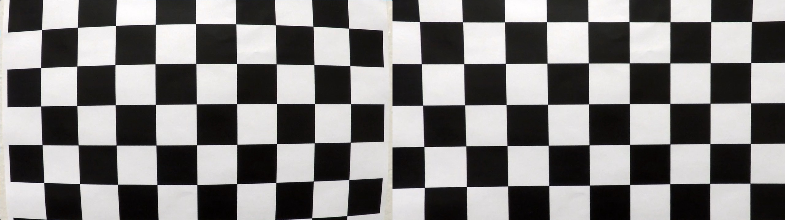

### Pipeline (single images)

#### 1. Provide an example of a distortion-corrected image.

`load_setup()` in `pipeline.py` loads the saved camera parameters, and `prepare_frame()` runs `cv2.undistort()` on every image as the first step.

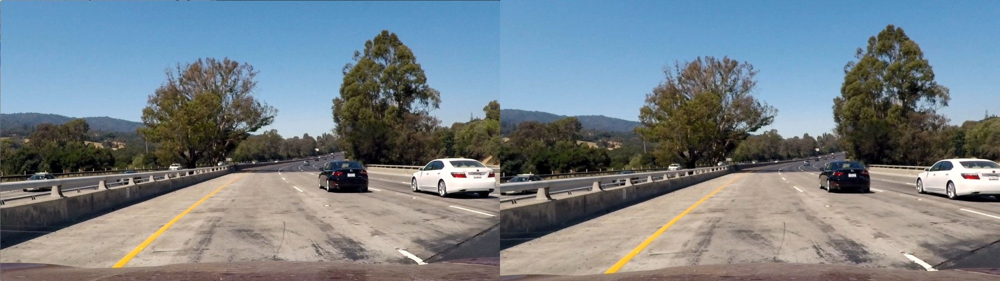

On a road photo the difference is small and mostly visible near the edges. It still matters later: the curvature in step 5 depends on the exact shape of the lines.

#### 2. Describe how (and identify where in your code) you used color transforms, gradients or other methods to create a thresholded binary image.  Provide an example of a binary image result.

The code is in `thresholding.py`. The idea is to combine two masks, one based on color, another based on edges, and then throw away everything that is clearly not road.

**Color** (`create_color_binary()`). Yellow and white lines need different approaches:

- *Yellow* is found in HLS: hue 15–40 (OpenCV uses a 0–179 scale), L ≥ 50, S ≥ 90. Hue doesn't change much between sun and shadow, so this works in both. But in `challenge02` (cloudy day, old paint) the yellow line is faded, with a saturation of only 45–120, and was mostly missed. Simply lowering S didn't work and the light concrete in `test1.jpg` is slightly yellowish too and the whole bridge lit up. So I added a second rule: a pixel also counts as yellow if its hue is right, S ≥ 40, and it is clearly *more yellow than its surroundings*. For "how yellow" I use the b channel of LAB, and for "more than its surroundings" the same top-hat trick as for white lines below (threshold 12). The concrete is evenly yellowish, so it disappears; the faded line is a thin stripe, so it stays.
- *White* was harder. With a fixed brightness threshold it either missed lines on dark asphalt or marked the entire light concrete bridge in `test1.jpg` as "white". So the threshold adapts to each image: I take the brightness of the road in the lower middle of the image and only keep pixels that are brighter than 97% of it.
- That still left patches of bright concrete. To remove them I added a **top-hat** filter (31×31): it keeps only thin things that are brighter than what surrounds them. A lane line is thin and bright; a concrete slab is wide, so it disappears.

**Gradient** (`create_gradient_binary()`). This helps where the color mask misses thin or distant lines:

- Sobel in x on the blurred L channel, threshold ≥ 30 and lane lines create strong left-right brightness changes.
- Gradient direction between 0.6 and 1.3 rad, in the camera image lane lines are diagonal, so this throws out horizontal and vertical edges.
- At first the gradient also found the edge between the road and the concrete barrier, which looks just like a long lane line. A lane line has two edges around a bright stripe, the barrier only one. So I keep gradient pixels only where the top-hat is also positive (≥ 10).

**Region of interest** (`create_region_mask()`): a trapezoid in front of the car. It cuts off the sky, trees, cars in other lanes and the hood.

**Cleanup** (`remove_small_components()`): any blob smaller than 30 px is deleted.

In the figure below each row is one image: corrected image, final binary mask, and which mask found what (green = color only, magenta = gradient only, white = both):

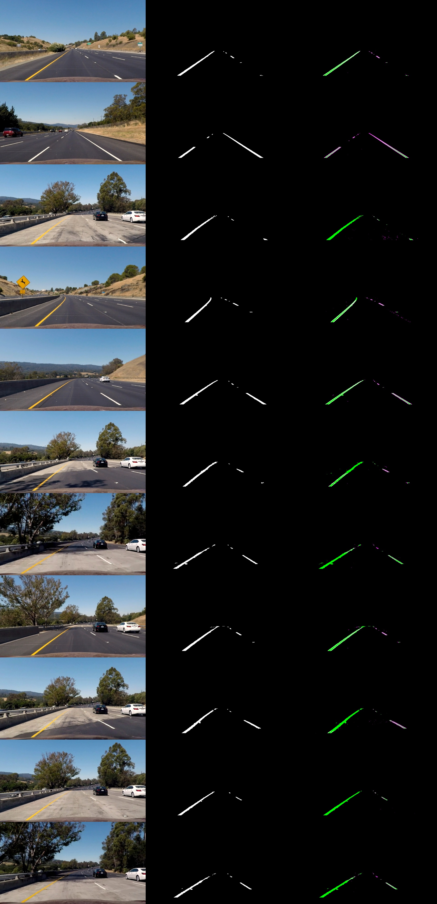

Most pixels come from the color mask. The gradient mostly adds far-away dashes and the thin white line on dark asphalt in `test2.jpg`. Both lines are found on all 11 images, including tree shadows (`test4`, `test5`) and the light bridge (`test1`, `test5`). The downside of the cleanup is that a few small far dashes on the right also disappear.

#### 3. Describe how (and identify where in your code) you performed a perspective transform and provide an example of a transformed image.

The code is in `perspective.py`; the transform itself is set up once in `load_setup()`.

I didn't want to guess the four source points by hand, so I measured them. On `straight_lines1.jpg` and `straight_lines2.jpg` the road is straight, which means the lane lines are straight lines. `estimate_source_points()` fits a straight line through the left and the right lane pixels (and refits after removing the 20% of pixels furthest from it). Where these lines cross y = 455 and the bottom of the image gives the four corners. I averaged the result over both images.

The destination is a rectangle in the middle half of the image:

| Source | Destination |
|:---:|:---:|
| 589, 455 | 320, 0 |
| 694, 455 | 960, 0 |
| 1108, 720 | 960, 720 |
| 213, 720 | 320, 720 |

`cv2.getPerspectiveTransform()` gives the matrix (and the inverse, which I need in step 6), and `warp_image()` applies it with `cv2.warpPerspective()`. For binary images I use nearest-neighbor interpolation so the mask stays black and white.

**How I checked it.** If the transform is right, straight lines become vertical and parallel, so the distance between them should be the same at the top and at the bottom. `measure_lane_widths()` measures it in three horizontal bands and `lane_finding.py` prints the result. On the straight images I get 633 / 632 / 633 px and 653 / 653 / 640 px — practically constant.

Each row: the source trapezoid, the warped image with the destination rectangle, and the warped binary mask. The first two rows are the straight roads:

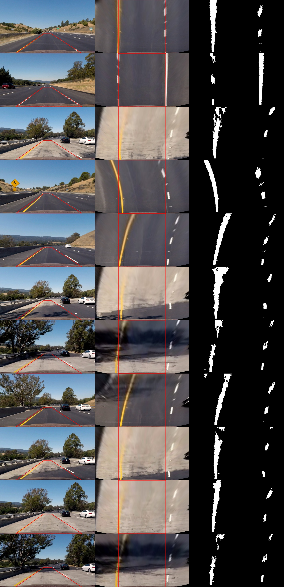

On the other images the road curves, so the lines bend, that's expected. The far part of the road gets stretched a lot, so pixels there are wider and noisier.

#### 4. Describe how (and identify where in your code) you identified lane-line pixels and fit their positions with a polynomial?

The code is in `lane_detection.py`; `find_lane()` does the whole step.

**Where to start** (`find_line_bases()`). Close to the car the lines are almost vertical in the bird's-eye view. If I count white pixels in every column of the bottom half, I get two peaks, one per line. The highest peak on the left and on the right are the starting points.

**Sliding windows** (`find_pixels_sliding_window()`). I split the image into 9 horizontal bands and move a 200 px wide window up from the bottom for each line. Pixels inside the window belong to that line. If the window found at least 50 pixels, the next one is centered on their average x. That way the windows follow a curve, and in the gaps of a dashed line they just keep going straight.

**Searching near the previous lane** (`find_pixels_around_fit()`). In a video the lane barely moves between frames, so I search only within ±80 px of the previous result instead of starting over.

**Fitting** (`fit_parallel_lines()`). Each line is a second-order polynomial `x = A·y² + B·y + C`. It is x as a function of y, because the lines are almost vertical and a function of x wouldn't work.

The standard approach fits each line separately. I tried that first, and the dashed line was a problem: it has few pixels, so its curve was unstable. On `test2.jpg` it even bent the opposite way to the solid line. But in the bird's-eye view the two lines of a lane are parallel — they have the same shape and are only shifted sideways. So I fit both together: A and B (the shape) are shared, and only C (the position) is different for each line. The solid line now "helps" the dashed one. I also give both lines the same total weight, otherwise the solid line with thousands more pixels would decide everything. If either line has fewer than 200 pixels, the step gives up and returns `None`.

On the straight images A comes out almost exactly zero, which is what it should be for a straight road.

Each row: the corrected image and the bird's-eye view with the windows (green), left and right line pixels (red and blue), and the fitted curves (yellow):

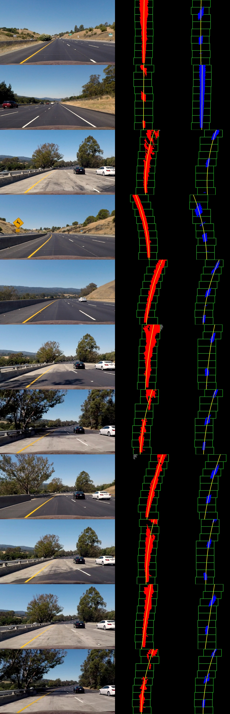

#### 5. Describe how (and identify where in your code) you calculated the radius of curvature of the lane and the position of the vehicle with respect to center.

The code is in `curvature.py`.

**Pixels to meters.** To get the curvature in meters I need to know how many meters one pixel is in the bird's-eye view. I measured this on the straight images:

- Across: the lane is about 640 px wide, and a US highway lane is 3.7 m, so `XM_PER_PIX = 3.7 / 640`.
- Along: a US dashed line repeats every 40 ft (12.2 m — 10 ft dash plus 30 ft gap). In my bird's-eye view that's about 300 px, so `YM_PER_PIX = 12.2 / 300`. This is close to the usual 30 m / 720 px.

**Radius** (`curvature_radius()`, `lane_curvature()`). I convert A and B to meters (`A·xm/ym²`, `B·xm/ym`) and use the formula for the radius of a curve:

R = (1 + (2·A·y + B)²)^1.5 / |2·A|

with y at the bottom of the image, right in front of the car. Since both lines share A and B, they give the same radius.

**Car position** (`vehicle_offset()`). I assume the camera sits in the middle of the car, so the car is at the bottom center of the camera image. I map that point into the bird's-eye view and compare it with the point halfway between the two lines. Positive means the car is right of center.

Results from `lane_finding.py`:

| Image | Radius | Offset |
|---|---|---|
| straight_lines1 | 5376 m | −0.08 m |
| straight_lines2 | 31883 m | −0.09 m |
| test1 | 480 m | −0.35 m |
| test2 | 553 m | −0.43 m |
| test3 | 538 m | −0.23 m |
| test4 | 1234 m | −0.30 m |
| test5 | 748 m | −0.04 m |
| test6 | 1053 m | −0.29 m |
| challange00101 | 771 m | −0.30 m |
| challange00111 | 14105 m | −0.14 m |
| challange00136 | 560 m | −0.06 m |

The straight roads give several kilometers basically straight. The curves give 0.5–1.2 km. `challange00111` is an outlier: it is on the same curve as its neighbors (0.77 and 0.56 km) but shows over 10 km. A single frame is simply not very reliable, which is why in the video I average over time. The car is slightly left of center everywhere. All numbers are rough, the meters-per-pixel scale itself is only accurate to about 10%.

#### 6. Provide an example image of your result plotted back down onto the road such that the lane area is identified clearly.

The code is in `overlay.py`.

`draw_lane_area()` fills the space between the two curves in the bird's-eye view (green, with the left line red and the right line blue), warps it back to the camera view with the inverse matrix from step 3, and blends it over the corrected image. `draw_measurements()` writes the radius and the car position on top. Anything above 5 km is shown as "straight".

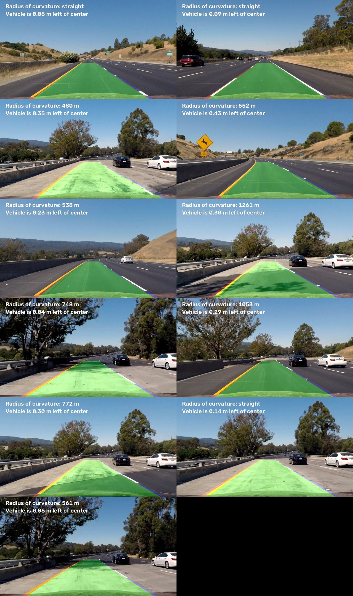

The green area follows the markings on all 11 images, including the shadows in `test4` and `test5`.

### Pipeline (video)

#### 1. Provide a link to your final video output.  Your pipeline should perform reasonably well on the entire project video (wobbly lines are ok but no catastrophic failures that would cause the car to drive off the road!).

Short previews (6 seconds from the middle of each video, made by `video.py`). Click a preview to open the full video.

| | |
|:---:|:---:|
| [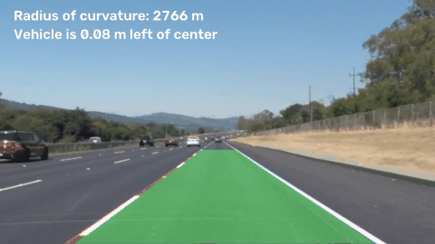](output_videos/project_video01_output.mp4) | [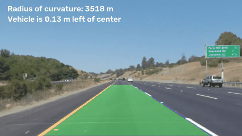](output_videos/project_video02_output.mp4) |
| project_video01 | project_video02 |
| [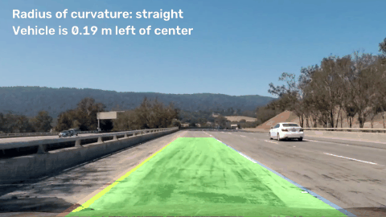](output_videos/project_video03_output.mp4) | [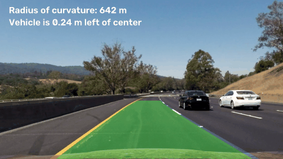](output_videos/challenge01_output.mp4) |
| project_video03 | challenge01 |
| [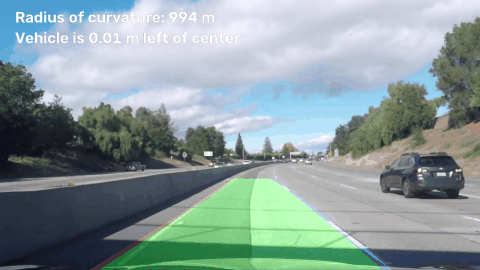](output_videos/challenge02_output.mp4) | [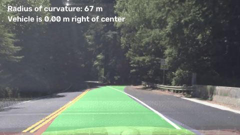](output_videos/challenge03_output.mp4) |
| challenge02 | challenge03 |

`video.py` runs the same steps on every frame. On its own a single frame can go wrong, because of a shadow, a missing dash, a wrong curvature like `challange00111` above. In a video I can use the frames before it, so `LaneTracker` in `tracking.py` adds a few things:

- Search near the last lane first, and only fall back to the sliding windows if that fails.
- Reject lanes that don't make sense (`is_plausible()`). The lane must be 3.0–4.5 m wide, the radius at least 30 m (mountain roads really do have curves that tight), and the car must be within 1 m of the lane center. On roads with a yellow center line, there must be no yellow *inside* the lane, if there is, the detection has jumped to the oncoming lane.
- Reject sudden jumps (`is_close()`). A line can't move more than 0.5 m between two frames, and the curvature 1/R can't change by more than 1/200 m⁻¹. A real road bends gradually, so a sudden bend means the fit was pulled by something that isn't a lane line.
- Smooth the result. The lane is the average of the last 5 good detections. For the radius I average 1/R over the last 30 frames (about a second). On an almost straight road one frame says 300 m and the next says "straight"; averaging 1/R instead of R keeps this stable.
- Don't draw across the yellow line (`find_clear_top()`). On sharp curves the parabola can bend into the oncoming lane far ahead, so the green area is cut off where yellow appears inside it.
- Start from the yellow line. If the yellow center line is clearly visible, the window search starts the left line there, instead of at a shadow or the road edge.
- Missing frames. If nothing good is found, the last lane stays on screen for up to 10 frames. After that the video says "Lane not detected" and the search starts over.

**A different camera angle in some videos** (`adapt_perspective()` in `video.py`). At first `challenge02` and `project_video02` were bad, even though the road looked easy. The reason was the camera: it's mounted at a slightly different angle than in the test images, so the horizon is 6–21 px higher or lower. That sounds tiny, but the top of my trapezoid is only about 35 px below the horizon. The lane in the bird's-eye view looked 2.8 m or 4.7 m wide, and the plausibility check threw it out.

So before processing a video, I sample 40 frames, fit straight lines to the near part of the lane and find where they meet it means that's the horizon. If it differs from the test images by more than 5 px (or the lane is more than 10% wider or narrower), the video gets its own trapezoid. This brought the lost frames down from 239 to about 10 in `challenge02` and from 43 to 0 in `project_video02`. (`project_video02` is actually from the other camera, no hood, same scene as `solidYellowLeft.jpg` — so the calibration doesn't strictly fit it, but the adapted perspective makes up for most of that.)

Videos with a different size are resized to 1280x720. The output is written in H.264 if OpenCV supports it, so it plays in QuickTime and the browser. For the README, `video.py` also saves a 6-second GIF from the middle of each video to `docs/`, because GitHub can't play an mp4 inside a README.

What `video.py` printed for each video. "Tracked" means found near the previous lane, "searched" found by a new window search, "reused" the previous lane was kept, "lost" nothing was shown:

| Video | Frames | Tracked | Searched | Reused | Lost | Perspective |
|---|---|---|---|---|---|---|
| project_video01 | 221 | 220 | 1 | 0 | 0 | own |
| project_video02 | 681 | 679 | 1 | 1 | 0 | own |
| project_video03 | 1260 | 1254 | 1 | 5 | 0 | from test images |
| challenge01 | 251 | 248 | 1 | 2 | 0 | from test images |
| challenge02 | 484 | 455 | 2 | 16 | 11 | own |
| challenge03 | 1199 | 576 | 49 | 325 | 249 | from test images |

On the three project videos and `challenge01` the lane is there in practically every frame. The lines wobble a little but never jump off the road. `challenge02` (concrete, a bridge, a different camera angle) shows the lane in 98% of frames.

`challenge03` is a different story. The lane is found in about half of the frames and missing in about a fifth. I decided it's better to show "Lane not detected" than a lane that leads into the oncoming lane or off the road, and tuned the checks for that.

### Discussion

#### 1. Briefly discuss any problems / issues you faced in your implementation of this project.  Where will your pipeline likely fail?  What could you do to make it more robust?

**What gave me trouble**

- *Light concrete and shadows.* A fixed threshold for white lines didn't work on both asphalt and concrete. An adaptive threshold plus the top-hat filter fixed it.
- *Faded yellow paint* in `challenge02`. Without it the lane shape depended only on the dashed line and sometimes bent off to the side. Looking for "more yellow than the surroundings" instead of "very saturated yellow" fixed this.
- *The barrier looked like a lane line* in the gradient mask. Keeping only thin bright stripes solved this.
- *Dashed lines* gave unstable curves on their own. Fitting both lines together with a shared shape fixed it.
- *Different camera angles* between videos. I didn't expect a few pixels of horizon to matter this much. Now the perspective is adjusted per video.
- *Jumping radius.* Averaging 1/R over a second made it readable.

**Where it still fails** (mostly `challenge03`)

- *Sharp curves.* The trapezoid and the region of interest look straight ahead, so on a hairpin the lane leaves the view. A parabola also can't describe an S-curve.
- *Sun and shadow under trees*, and glare when driving into the sun. The color thresholds stop working and shadow edges look like lines.
- *Hills.* Going up or down moves the horizon, but my perspective is fixed for the whole video.
- *Built-in assumptions:* camera in the middle of the car, lane 3–4.5 m wide, US markings (yellow center line, 40 ft dashes). Other countries' markings, worn paint, rain, night or snow aren't handled.

**What I would try next**

- Equalize brightness locally (CLAHE) before thresholding, against shadows and glare.
- A shorter bird's-eye view on curvy roads, and splines instead of a parabola.
- Update the perspective continuously from the horizon, not once per video.
- A Kalman filter instead of a simple average, to predict the lane through missing frames.
- For really hard roads a neural network for lane segmentation, which is how it's usually done today.
